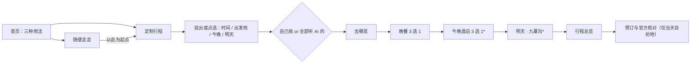

# Chengdu Lens · 产品案例

> 一个面向国际自由行游客的城市行程决策助手：用户只说出自己的时间、位置、住宿和下一站，就能得到一份自己选、能执行、知道该核对什么的行程。

[在线体验](https://chengdulens.lovable.app) · [产品规格](product-spec-cn.md) · [指标体系](product-metrics-cn.md) · [产品蓝图](product-roadmap-cn.md) · [English](product-case-study-en.md)

## 1. 摘要

| 项 | 内容 |
| --- | --- |
| **目标用户** | 第一次来成都、停留二到四天、以英语为主、不熟悉中国旅行应用的国际自由行游客 |
| **核心问题** | 信息不缺，缺的是「在我当下的时间、位置和限制里，下一步去哪」的快速决定 |
| **产品判断** | 当推荐写清「为什么适合你」、事实交给官方核对、每一步都由用户确认时，建议更容易被真正执行 |
| **我的职责** | 问题定义、场景拆分、需求与交互、AI 分层与边界、指标体系、原型开发与双语交付 |
| **本版交付** | 双模式首页（随便走走 / 定制行程）、按需求生成的分步工作台、自动天气与雨天路线、可选九寨沟一日、按目的地展示的模拟预订与退款、双语与移动端 |
| **质量保障** | 12 条规则单元测试 + 中英文、桌面与手机端到端走查 |

## 2. 问题定义

成都的旅游内容已经过载。对第一次来的国际游客，难点是决策成本：

- **可信度难判断**：内容平台里灵感、广告和真实体验混在一起，且多为中文。
- **灵感到执行断层**：知道想去宽窄巷子，却不知道和下一站怎么接、下雨怎么办、晚饭能不能不辣。
- **跨城衔接复杂**：去九寨沟是「高铁 → 到站接驳 → 沟口住宿」的多段组合，很容易被理解成一张票全包。
- **本地规则陌生**：实名预约、景区限流、支付方式和点餐沟通都与游客习惯不同。

所以机会不在「生成更多攻略」，而在**决策层**：把地点、天气、时间和偏好组织成「我能完成的一天」，并在关键事实上把用户交给官方渠道。

## 3. 用户与场景

按任务而不是按国籍拆分场景。同一个游客在一天里会有完全不同的心态：

| 场景 | 用户原话 | 心理负担 | 产品给出的 |
| --- | --- | --- | --- |
| A · 随性漫游 | 「在文殊院附近，想出去走两小时，找个地方喝茶」 | 低：想要惊喜，不想填表 | 1–3 小时的惊喜路线，可换一条，可带入正式行程 |
| B · 安排今天 | 「从太古里出发四小时，不吃辣」 | 中：要可行、要好吃 | 选地点 → 三选一晚餐 → 需要时三选一酒店 |
| C · 今天 + 周边 | 「今晚住成都，明天去九寨沟」 | 高：跨城、过夜、多段交通 | 在 B 之上分段说明高铁、接驳、住宿与晚餐 |

**关键设计：** 三种场景在首页平级出现，产品不替用户选默认值。

## 4. 产品原则

1. **不替用户决定没说过的事。** 时间、出发地、今晚、明天四项要么说出、要么点选；缺什么问什么。周边目的地只在用户选择后出现。
2. **用户来选，AI 补空。** 每一步都可以自己挑，也可以「全部听 AI 的」；AI 只补空位，不覆盖已选项。
3. **事实与建议分开。** 价格、班次、营业与余票指向官方入口，由规则和精选资料负责，语言模型只负责理解与解释。
4. **付款不等于预订成功。** 付款状态与预订状态分开管理，完整演示「付款成功但订房失败 → 退款」。
5. **每一步可回退。** 晴天与雨天的选择分开保存；明天可以加上，也可以移除，今天不受影响。

## 5. 体验设计

* 仅在用户需要时出现

- **首屏只回答「我能用它做什么」**：三个入口直接进入对应模式，没有预设时长、站点或目的地。
- **一句话 + 点选**：打字时下方选项实时点亮，点选随时可纠正解析；四项没齐时开始按钮不可用，并明确列出还差什么。
- **步骤由需求生成**：已有住处就没有酒店步骤；没选明天就没有九寨沟步骤。
- **天气自动感知**：实时读取成都天气，下雨时自动切到室内与带顶棚的地点（博物馆、方所、文殊院），一键可手动更正。
- **预订是独立抽屉**：只展示当天目的地的选项，交易状态可回看，不混在对话里。

## 6. AI 与系统设计

| 层 | 负责 | 说明 |
| --- | --- | --- |
| 确定性规则层 | 路线时长、晴雨替换、步骤生成、托管填空、预订范围、交易状态 | 纯函数模块，可单元测试、结果可复现 |
| 精选知识层 | 9 个成都地点、周边推荐、交通、官方链接与来源 | 每条记录都有出处，事实可追溯 |
| AI 语言层 | 理解开放问题、解释取舍、文化与沟通建议 | 基于精选记录与当前对话作答 |

**关键取舍：**

| 问题 | 决策 | 理由 |
| --- | --- | --- |
| 托管用模型还是规则？ | 规则 | 演示稳定，每个选择都能解释来源 |
| 预订放在对话里吗？ | 独立抽屉 | 交易需要可回看的状态和明确的用户确认 |
| 预订范围由谁决定？ | 用户操作与明确输入 | 生成文字不会打开无关目的地的库存 |
| 周边做几条？ | 先把九寨沟做深 | 先跑通「城市 + 周边」的完整链路，再复制 |

详见 [Agent 系统设计](agent-system-design-cn.md)。

## 7. 指标

| 层级 | 指标 | 定义 |
| --- | --- | --- |
| 北极星 | 可执行行程率 | 保存行程总览或打开官方核对的用户 ÷ 开始填写需求的用户 |
| 过程 | 首屏进入率、需求完成率、首个计划耗时、托管占比、漫游扩展率、明天延伸率 | 找到流失点，判断用户更信任自选还是托管 |
| 护栏 | 预设场景、静默改写已选项、未选目的地出现预订、付款成功未退款 | 目标恒为 0，出现即阻断发布 |

完整口径、看板和埋点见 [指标体系](product-metrics-cn.md)。

## 8. 交付过程

| 阶段 | 关键决定 | 结果 |
| --- | --- | --- |
| 1 · 发现式原型 | 先做地点发现与收藏 | 发现用户真正卡在「怎么串成一天」 |
| 2 · 连续旅程 | 把今天与明天合并成一次对话，预订按目的地限定 | 去掉了「没说九寨沟却出现九寨沟报价」的困惑 |
| 3 · 主线 + 分支 | 一句话需求 → 分步工作台，晚餐与酒店三选一，可全部托管 | 用户路径从「看内容」变成「做决定」 |
| 4 · 双模式 | 区分随性漫游与结构化规划 | 覆盖低负担与高确定性两种旅行心态 |
| 5 · 不预设 | 首页与规划器只使用用户说出的信息 | 每一份行程都是用户自己的 |

## 9. 我做了什么

- **定义问题与范围**：把「旅游 AI」收敛成「决策层」，选定国际首访游客与「城市 + 一条周边」作为首发范围。
- **设计体验**：双模式入口、需求采集、按需步骤、三选一分支、托管与自选共用进度。
- **设计 AI 边界**：规则、知识、语言三层分工；交易与预订范围不由模型触发。
- **建立度量**：北极星、过程与护栏指标，埋点事件表与发布门槛。
- **交付原型**：独立完成前端、规则模块、测试与双语内容，并持续根据走查迭代。

## 10. 演进方向

1. **第二条周边线路**（都江堰·青城山或峨眉·乐山），验证目的地可插拔。
2. **来源与核对日期**：每条地点记录带维护人和核对日期，过期自动标为「待核对」。
3. **验证闭环**：5 场可用性测试与 AI 离线评测集，作为进入下一座城市的门槛。
4. **真实交易渠道**：在护栏指标持续为 0 的前提下，优先对接酒店或景区预约。
