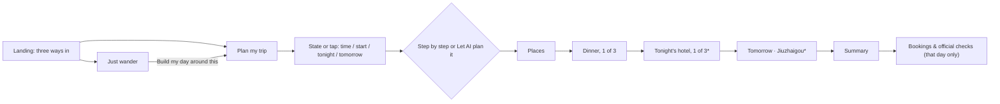

# Chengdu Lens · Product case study

> A trip-decision assistant for international independent travelers: say your time, location, stay and next stop, and get a plan you chose, can act on, and know what to verify.

[Live demo](https://chengdulens.lovable.app) · [Product spec](product-spec-en.md) · [Metrics](product-metrics-en.md) · [Roadmap](product-roadmap-en.md) · [中文](product-case-study-cn.md)

## 1. Summary

| Item | Detail |
| --- | --- |
| **Target user** | First-time international visitors to Chengdu, staying two to four days, English-first, new to Chinese travel apps |
| **Core problem** | Plenty of content, but no quick answer to "given my time, place and limits, where next?" |
| **Product bet** | Advice gets acted on when it explains why it fits, hands facts to official sources, and lets the traveler confirm every step |
| **My role** | Problem framing, scenario design, requirements and interaction, AI layering and boundaries, metrics, prototype build and bilingual delivery |
| **Shipped** | Two-mode landing (Just wander / Plan my trip), brief-driven workbench, live weather with rain routes, optional Jiuzhaigou day, destination-scoped simulated booking and refund, bilingual and mobile |
| **Quality** | 12 rule-level unit tests plus end-to-end walkthroughs in English and Chinese, desktop and mobile |

## 2. Problem

Chengdu has more travel content than anyone can read. For a first-time international visitor the cost is in deciding:

- **Hard to trust**: inspiration, ads and real experiences blur together, mostly in Chinese.
- **Gap from idea to action**: you want Kuanzhai Alley, but not how it links to the next stop, what to do in rain, or where to eat without spice.
- **Complex regional links**: Jiuzhaigou is rail → onward transfer → stay near the gate, easily mistaken for one ticket.
- **Unfamiliar local rules**: real-name reservations, visitor caps, payments and ordering all differ from home.

The opportunity is the **decision layer**: turn places, weather, time and preference into "a day I can actually do", and route key facts to official channels.

## 3. Users and scenarios

Scenarios are split by job, not nationality. The same traveler shifts mindset within a day:

| Scenario | In their words | Cognitive load | Product response |
| --- | --- | --- | --- |
| A · Spontaneous walk | "Near Wenshu, two hours, somewhere for tea" | Low: wants surprise, no forms | A 1–3 hour surprise route; shuffle, or carry into a plan |
| B · Plan today | "Four hours from Taikoo Li, no spicy food" | Medium: must work and taste good | Pick places → 1 of 3 dinners → 1 of 3 hotels if needed |
| C · Today + a regional day | "Staying in Chengdu tonight, Jiuzhaigou tomorrow" | High: cross-city, overnight, multi-leg | B plus rail, transfer, stay and dinner explained leg by leg |

**Key decision:** all three sit side by side on the landing page; the product picks no default for the traveler.

## 4. Principles

1. **Never decide what the traveler hasn't said.** Time, start, tonight and tomorrow are stated or tapped; ask only for what is missing. Regional destinations appear only once chosen.
2. **The traveler chooses; AI fills gaps.** Every step can be picked by hand or by "Let AI plan it", which never overwrites existing choices.
3. **Separate facts from advice.** Prices, schedules, hours and availability point to official sources; rules and curated records own facts, the model owns understanding and explanation.
4. **Payment is not confirmation.** Payment and booking states are tracked separately, including "paid, but hotel failed → refund".
5. **Everything is reversible.** Fair-weather and rain picks are stored separately; tomorrow can be added or removed without touching today.

## 5. Experience design

* only when the traveler asks for it

- **The first screen answers "what can it do for me"**: three entries open their modes, with no preset duration, stop or destination.
- **Sentence + taps**: chips light up as you type and can always correct the parse; start buttons stay disabled until all four fields are set, listing what is missing.
- **Steps follow the brief**: already have a room, no hotel step; no tomorrow, no Jiuzhaigou step.
- **Weather-aware**: live Chengdu weather switches rain days to indoor and covered places (museum, Fangsuo, Wenshu), with a one-tap correction.
- **Booking is its own drawer**: only that day's destination, with reviewable transaction state, separate from chat.

## 6. AI and system design

| Layer | Owns | Notes |
| --- | --- | --- |
| Deterministic rules | Route time, rain swaps, step generation, AI fill, booking scope, transaction state | Pure modules, unit-tested, reproducible |
| Curated knowledge | Nine Chengdu places, nearby picks, transport, official links and sources | Every record cites a source |
| AI language | Open questions, trade-off explanations, culture and communication tips | Answers from curated records and the current conversation |

**Key trade-offs:**

| Question | Decision | Why |
| --- | --- | --- |
| Rules or model for AI fill? | Rules | Stable demo; every pick explains its origin |
| Booking inside chat? | Separate drawer | Transactions need reviewable state and explicit confirmation |
| Who sets booking scope? | Traveler actions and explicit input | Generated text never opens unrelated inventory |
| How many regional routes? | Go deep on Jiuzhaigou first | Prove the full city-plus-region chain, then replicate |

See [Agent system design](agent-system-design-en.md).

## 7. Metrics

| Level | Metric | Definition |
| --- | --- | --- |
| North star | Actionable plan rate | Travelers who save a summary or open an official check ÷ travelers who start a brief |
| Diagnostics | Entry rate, brief completion, time to first plan, AI-fill share, wander carry-over, regional add-on | Where people drop off; whether they trust manual or AI-filled plans |
| Guardrails | Preset scenarios, silent overwrites, booking for an unchosen destination, paid-but-unrefunded | Always 0; any occurrence blocks release |

Definitions, dashboard and events: [Metrics](product-metrics-en.md).

## 8. How it evolved

| Stage | Key decision | Outcome |
| --- | --- | --- |
| 1 · Discovery prototype | Start with place discovery and saves | Learned the real blocker is stitching places into a day |
| 2 · Continuous journey | Merge today and tomorrow into one conversation; scope booking by destination | No more Jiuzhaigou quotes before Jiuzhaigou was mentioned |
| 3 · Mainline + branches | One-sentence brief → step-by-step workbench, 1-of-3 dinners and hotels, full AI fill | The path shifted from reading content to making decisions |
| 4 · Two modes | Separate spontaneous wandering from structured planning | Covers both low-effort and high-certainty travel mindsets |
| 5 · No presumption | Landing and planner use only what the traveler said | Every plan belongs to the traveler |

## 9. What I did

- **Framed the problem and scope**: narrowed "travel AI" to the decision layer; chose first-time international visitors and "one city + one regional route" for launch.
- **Designed the experience**: two-mode entry, brief capture, brief-driven steps, 1-of-3 branches, shared progress between manual and AI fill.
- **Set AI boundaries**: rules, knowledge and language layers; transactions and booking scope never triggered by the model.
- **Built measurement**: north star, diagnostics and guardrails, an event schema and release gates.
- **Shipped the prototype**: front end, rule modules, tests and bilingual content, iterated through walkthroughs.

## 10. Evolution

1. **A second regional route** (Dujiangyan–Qingchengshan or Emei–Leshan) to prove destinations are pluggable.
2. **Sources with verification dates**: each record carries an owner and check date; stale records switch to "verify".
3. **Validation loop**: five usability sessions and an offline AI evaluation set as the gate to the next city.
4. **Live transaction partners**: once guardrails hold at zero, connect hotels or attraction reservations first.
