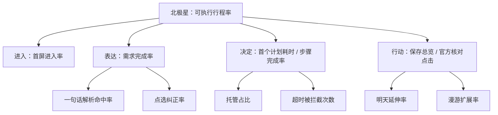

# Chengdu Lens · 指标体系与 AI 治理

[产品规格](product-spec-cn.md) · [Agent 评测用例](agent-evaluation-cases-cn.md) · [English](product-metrics-en.md)

> 衡量的不是「聊了多少」，而是「游客有没有得到一份自己选、能执行的行程」。

## 1. 指标树

## 2. 北极星指标

| 项 | 定义 |
| --- | --- |
| 名称 | 可执行行程率（Actionable Plan Rate） |
| 公式 | 保存行程总览或打开至少一个官方核对链接的游客 ÷ 开始填写需求的游客 |
| 统计窗口 | 单次访问（session）；跨天草稿按首次开始日计 |
| 为什么选它 | 同时覆盖「得到计划」与「准备执行」，不奖励无效对话轮数 |
| 首版目标 | ≥ 35% |

## 3. 过程指标

| 阶段 | 指标 | 口径 | 首版目标 | 用来回答 |
| --- | --- | --- | --- | --- |
| 进入 | 首屏进入率 | 点击任一用法或模式的访客 ÷ 访客 | ≥ 60% | 首屏是否讲清能做什么 |
| 表达 | 需求完成率 | 四项必填齐全 ÷ 开始填写 | ≥ 70% | 需求采集是否足够轻 |
| 表达 | 一句话解析命中率 | 打字后无需点选纠正的字段 ÷ 被解析字段 | ≥ 80% | 自然语言是否省事 |
| 决定 | 首个计划耗时 | 进入定制到到达总览的中位时长 | ≤ 3 分钟 | 决策是否高效 |
| 决定 | 托管占比 | 选择「全部听 AI 的」的行程 ÷ 开始的行程 | 观察值 | 用户更信任自选还是托管 |
| 行动 | 明天延伸率 | 加入九寨沟的行程 ÷ 总览 | 观察值 | 周边需求的真实规模 |
| 行动 | 漫游扩展率 | 带入定制的漫游路线 ÷ 生成的漫游路线 | ≥ 15% | 两种模式能否互相导流 |

## 4. 护栏指标

| 指标 | 目标 | 监测方式 |
| --- | --- | --- |
| 首页或规划器出现预设场景 | 0 | 单元测试 + 发布前走查 |
| 托管静默改写已选项 | 0 | 单元测试 |
| 路线估算超出可用时间 | 0 | 单元测试 |
| 未选目的地出现预订项 | 0 | 单元测试 + 事件 `booking_opened` 校验 |
| 「已付款」被显示为「已预订」 | 0 | 状态机测试 |
| 付款成功但订单失败未退款 | 0 | 状态机测试 |
| AI 回答中的事实性错误（营业时间、票价） | ≤ 1% | 离线评测集抽检 |

任一护栏为非 0 即阻断发布。

## 5. 看板设计

| 看板 | 视图 | 读者 |
| --- | --- | --- |
| 主线漏斗 | 进入 → 需求完成 → 开始 → 总览 → 核对/预订，按模式与语言拆分 | 产品、设计 |
| 需求采集 | 各字段的解析命中、点选纠正、缺失停留 | 产品、算法 |
| 天气与路线 | 雨天占比、自动检测被手动更正的比例、雨天路线站数 | 内容运营 |
| 交易健康 | 报价 → 确认 → 付款结果 → 退款，按目的地 | 产品、交易 |
| AI 质量 | 评测集通过率、护栏命中、人工抽检结论 | 产品、算法 |

## 6. 埋点事件

事件与属性的完整清单见 [产品规格 · 12.2](product-spec-cn.md)。命名规则：`对象_动作`，属性只记录行为与选择，不记录个人身份信息。

## 7. AI 治理

### 7.1 系统分层：规则优先于生成
- **确定性规则层**：路线时长、晴雨替换、步骤生成、托管填空、预订范围、付款状态。可测试、可复现。
- **精选知识层**：地点、周边、交通与官方链接，每条记录都有出处。
- **AI 语言层**：理解需求、解释取舍、回答开放问题；交易与预订由用户操作触发。

### 7.2 评测准则
| 维度 | 判定标准 |
| --- | --- |
| 准确 | 事实只引用精选记录，其余引导至官方核对 |
| 可执行 | 路线总时长在用户可用时间之内 |
| 边界 | 预订与付款只由用户操作触发 |
| 尊重偏好 | 不吃辣、素食等偏好贯穿推荐与说明 |
| 不预设 | 不补出用户没有说过的时间、住宿或目的地 |

### 7.3 发布门槛
每次修改提示词、模型或规则后：
1. 单元测试全部通过；
2. [Agent 评测用例](agent-evaluation-cases-cn.md)跑完，P0 用例 100% 通过；
3. 护栏指标全部为 0；
4. 中英文、桌面与手机走查主线一次。
