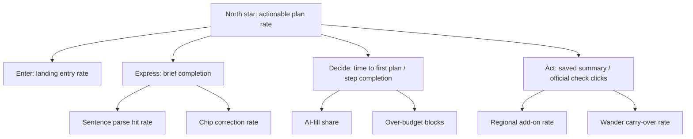

# Chengdu Lens · Metrics and AI governance

[Product spec](product-spec-en.md) · [Agent evaluation cases](agent-evaluation-cases-en.md) · [中文](product-metrics-cn.md)

> We measure whether the traveler ended up with a plan they chose and can act on, not how much they chatted.

## 1. Metric tree

## 2. North star

| Item | Definition |
| --- | --- |
| Name | Actionable Plan Rate |
| Formula | Travelers who save a summary or open at least one official check ÷ travelers who start a brief |
| Window | Per session; multi-day drafts count on the day they started |
| Why | Captures both "got a plan" and "ready to act", without rewarding chat volume |
| Launch target | ≥ 35% |

## 3. Diagnostic metrics

| Stage | Metric | Definition | Launch target | Answers |
| --- | --- | --- | --- | --- |
| Enter | Landing entry rate | Visitors who click any entry or mode ÷ visitors | ≥ 60% | Does the first screen explain what it does? |
| Express | Brief completion | All four required fields set ÷ briefs started | ≥ 70% | Is capture light enough? |
| Express | Sentence parse hit rate | Parsed fields not corrected by chips ÷ parsed fields | ≥ 80% | Does natural language save effort? |
| Decide | Time to first plan | Median time from Plan my trip to summary | ≤ 3 min | Is deciding efficient? |
| Decide | AI-fill share | Plans using "Let AI plan it" ÷ plans started | Observe | Do travelers trust manual or AI fill? |
| Act | Regional add-on rate | Summaries with Jiuzhaigou ÷ summaries | Observe | How large is regional demand? |
| Act | Wander carry-over rate | Wander routes carried into a plan ÷ routes generated | ≥ 15% | Do the two modes feed each other? |

## 4. Guardrails

| Metric | Target | Monitoring |
| --- | --- | --- |
| Preset scenario on landing or planner | 0 | Unit tests + pre-release walkthrough |
| AI fill silently overwrites a choice | 0 | Unit tests |
| Route estimate exceeds available time | 0 | Unit tests |
| Booking shown for an unchosen destination | 0 | Unit tests + `booking_opened` validation |
| "Paid" displayed as "booked" | 0 | State-machine tests |
| Paid but failed, not refunded | 0 | State-machine tests |
| Factual errors in AI answers (hours, prices) | ≤ 1% | Offline eval sampling |

Any non-zero guardrail blocks release.

## 5. Dashboards

| Dashboard | View | Audience |
| --- | --- | --- |
| Mainline funnel | Entry → brief complete → start → summary → check/book, by mode and language | Product, design |
| Brief capture | Parse hits, chip corrections and drop-off per field | Product, ML |
| Weather & routes | Rain share, auto-detect corrections, stops per rain route | Content ops |
| Transaction health | Quote → confirm → payment result → refund, by destination | Product, commerce |
| AI quality | Eval pass rate, guardrail hits, human review notes | Product, ML |

## 6. Events

The full event and property list lives in [Product spec · 12.2](product-spec-en.md). Naming: `object_action`; properties record behavior and choices only, never personal data.

## 7. AI governance

### 7.1 Layers: rules before generation
- **Deterministic rules**: route time, rain swaps, step generation, AI fill, booking scope, payment state. Testable and reproducible.
- **Curated knowledge**: places, nearby picks, transport and official links, each with a source.
- **AI language**: understands intent, explains trade-offs, answers open questions; transactions and bookings are triggered by traveler actions.

### 7.2 Evaluation criteria
| Dimension | Pass when |
| --- | --- |
| Accuracy | Facts come from curated records; everything else points to an official check |
| Feasibility | Total route time fits the traveler's available time |
| Scope | Booking and payment are triggered only by traveler actions |
| Preferences | No-spice, vegetarian and similar choices carry through picks and copy |
| No presumption | Never fills in time, stay or destination the traveler didn't state |

### 7.3 Release gate
After any change to prompts, models or rules:
1. All unit tests pass;
2. The [evaluation cases](agent-evaluation-cases-en.md) run with 100% P0 pass;
3. Every guardrail is 0;
4. One mainline walkthrough in English and Chinese, desktop and mobile.
