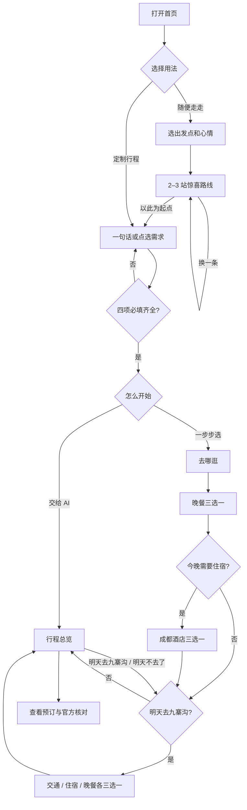
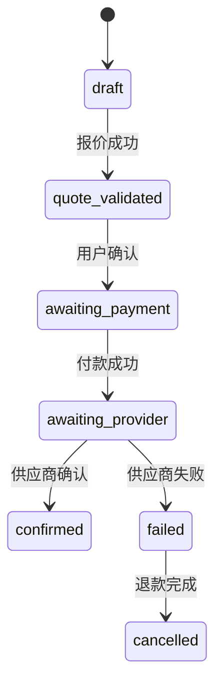

# Chengdu Lens · 产品需求规格说明（PRD）

> 帮第一次来成都的国际自由行游客，用一句话把「接下来去哪、吃什么、住哪、明天怎么走」变成一份自己选、能执行、知道该核对什么的行程。

| 项 | 内容 |
| --- | --- |
| 文档版本 | v1.0 |
| 产品版本 | 作品集原型 v0.4（可在线体验） |
| 负责人 | 产品经理（本人）：问题定义、用户与场景、需求与交互、指标体系、AI 边界、原型交付 |
| 阅读对象 | 设计、研发、测试、内容运营，以及评估本项目的面试官 |
| 相关文档 | [演示验收](demo-spec-cn.md) · [产品蓝图](product-roadmap-cn.md) · [指标体系](product-metrics-cn.md) · [Agent 系统设计](agent-system-design-cn.md) · [Agent 评测用例](agent-evaluation-cases-cn.md) · [研究与证据](research-evidence-appendix-cn.md) · [English](product-spec-en.md) |

目标值、验证任务与埋点表是规划口径；执行结果按版本单独记录。

**阅读指引：** 第 1–5 章回答「为什么做、为谁做」；第 6–9 章是可直接开发与测试的需求；第 10–13 章是 AI 治理、非功能、指标与埋点；第 14–15 章是验收与演进。标注「本版」的内容已在原型中实现，标注「演进」的内容属于完整产品规划。

---

## 1. 概述

### 1.1 产品定位
Chengdu Lens 是一个面向国际自由行游客的**城市行程决策助手**。它不生产更多攻略，而是把游客自己说出的时间、位置、住宿和下一站，转成一份可执行、可解释、可回退的安排，并把需要官方核对的事实清楚地交给官方渠道。

### 1.2 一句话价值
**少输入，多确定：** 随性漫游只需出发地和心情；定制行程明确四件事（多长时间、从哪出发、今晚是否需要住处、明天是否继续），再得到一份自己参与决策的行程。

### 1.3 本版目标
| 目标 | 衡量方式 | 本版目标值 |
| --- | --- | --- |
| 让游客在首屏就知道产品能为自己做什么 | 首屏进入任一模式的比例 | ≥ 60% |
| 让游客用最少输入得到可执行计划 | 开始填写需求 → 保存行程总览 | ≥ 35% |
| 不替游客做未表达的决定 | 预设场景、静默改写已选项的发生次数 | 0 |
| 交易状态始终真实可信 | 「已付款」被误显示为「已预订」的次数 | 0 |

---

## 2. 背景与机会

### 2.1 用户问题
首次来成都的国际游客并不缺信息，缺的是**在当下条件里做决定的能力**：

- **信息可信度难判断：** 内容平台的种草、广告与真实体验混在一起，且多为中文。
- **从灵感到执行有断层：** 知道「想去宽窄巷子」，但不知道和下一站怎么接、雨天怎么办、晚饭吃什么不辣。
- **跨城衔接复杂：** 去九寨沟需要「高铁 → 到站接驳 → 沟口住宿」多段组合，任何一段都容易被误解成「一张票全包」。
- **本地规则陌生：** 实名预约、景区限流、支付方式和点餐沟通都与游客习惯不同。

### 2.2 现有方案对比
| 类型 | 擅长 | 留下的空白 | 本产品的切入点 |
| --- | --- | --- | --- |
| 内容平台 | 灵感、氛围 | 适配性与可信度要用户自己判断 | 每个推荐写清「为什么适合你」与来源 |
| 地图导航 | 路径与距离 | 不解释为什么去、去了做什么 | 把地点组织成有时间预算的路线 |
| OTA | 标准化交易 | 城市深度体验被压缩成套餐 | 先帮用户决定，再进入对应预订 |
| 通用 AI | 快速生成攻略 | 营业时间、班次、库存需另行核实 | 规则与知识库负责事实，AI 负责理解与解释 |

### 2.3 机会判断
产品机会在于**决策层**：把分散的地点、天气、时间和偏好组织成「我能完成的一天」，并在关键事实上把用户交给官方渠道。这一层既能独立创造价值，也是未来连接预订与商家合作的入口。

---

## 3. 目标用户

### 3.1 首发用户画像
| 维度 | 描述 |
| --- | --- |
| 身份 | 英语为主的国际自由行游客，第一次到成都 |
| 停留 | 2–4 天，常在成都和一个周边目的地之间安排 |
| 设备 | 以手机为主，在酒店、街头、地铁上随时打开 |
| 能力 | 不熟悉中文 App、实名预约与本地支付 |
| 动机 | 想体验本地生活（茶馆、街巷、美食），而不只是打卡热门景点 |
| 约束 | 时间有限，常有饮食限制（不吃辣、素食），对天气变化敏感 |

### 3.2 用户分层变量
产品不按国籍建模，而按以下可观察变量调整推荐：中国旅行熟悉度、语言能力、可用时间、出发位置、饮食限制、是否需要住宿、是否跨城。

### 3.3 核心场景与用户故事
三个场景对应三种不同的认知负担，产品在首屏同时呈现，不把任何一种当作默认。

| 场景 | 典型说法 | 用户故事 | 产品给出 |
| --- | --- | --- | --- |
| A. 临时想走走 | 「我在文殊院附近，有两小时，想喝茶发呆」 | 作为一个刚好有空的游客，我想马上得到一条短路线，这样不用研究就能出门 | 1–3 小时惊喜路线，可换一条，可扩展成完整行程 |
| B. 安排今天 | 「下午四小时，从太古里出发，不吃辣」 | 作为一个有半天时间的游客，我想挑几个感兴趣的地方并知道晚饭去哪，这样时间不会浪费在比较上 | 选地点 → 晚餐三选一 →（需要时）今晚住宿三选一 → 总览 |
| C. 今天＋周边一日 | 「今晚住成都，明天去九寨沟」 | 作为一个要跨城的游客，我想把今天和明天连成一个计划，并看清每段交通分别怎么解决 | B ＋ 明天：交通接驳、沟口住宿、晚餐各三选一 |

---

## 4. 设计原则

| # | 原则 | 在产品中的体现 |
| --- | --- | --- |
| 1 | **用户没说的，不替他决定** | 时间、出发地、今晚、明天四项由用户说出或点选；缺哪项只问哪项；周边目的地只在用户选择后出现 |
| 2 | **用户选，AI 补** | 每一步都能自己选，也能「交给 AI」；托管只填空，不覆盖已选内容 |
| 3 | **事实与建议分开** | 票价、班次、营业时间、余票交给官方渠道核对；AI 负责解释取舍 |
| 4 | **付款不等于预订成功** | 付款状态与预订状态分开管理，完整呈现「付款成功但订房失败 → 退款」 |
| 5 | **每一步都可回退** | 晴天与雨天选择分开保存；明天可加可删，今天的选择保持不变 |
| 6 | **一屏只做一件事** | 工作台一次展示一个步骤，候选项最多三个，降低选择负担 |

---

## 5. 版本范围

| 能力 | 本版 | 演进方向 |
| --- | --- | --- |
| 地点知识 | 9 个精选成都地点，含介绍、门票、交通、周边与最佳时间 | 来源责任人与核对日期，覆盖更多片区与城市 |
| 周边目的地 | 九寨沟（含黄龙、松潘资料） | 都江堰、青城山等，验证目的地可插拔 |
| 天气 | Open-Meteo 实时天气自动判断晴雨，可手动更正 | 逐小时预报，提前提醒下午转雨 |
| 路线时长 | 片区网格估算 | 接入地图路径与实时交通 |
| 预订与支付 | 本地模拟报价、确认、付款与退款，保证演示可复现 | 对接供应商与支付渠道，保留同一状态模型 |
| AI 向导 | 基于精选资料与当前对话的自由问答 | 证据检索、可执行性检查工具、离线评测集 |
| 语言 | 中英文完全对等 | 更多语种与菜单翻译卡片 |

---

## 6. 信息架构与主流程

### 6.1 信息架构
```text
首页
├─ 首屏：产品定位 + 三种用法（随便走走 / 安排今天 / 延伸到明天）+ 实时天气
├─ 模式切换
│   ├─ 随性漫游：我在哪 + 心情 → 惊喜路线 → [换一条] / [以此为起点安排今天]
│   └─ 定制行程：一句话或点选 → 需求齐全 → [交给 AI] / [一步步选]
│        └─ 工作台：去哪逛 → 晚餐 → 今晚住宿* → 明天·九寨沟* → 行程总览
│              └─ 预订抽屉（仅当天目的地）→ 模拟报价 → 确认 → 付款 / 失败 / 退款
├─ 地点详情（任意卡片可打开）：介绍、门票、交通、周边推荐、来源
├─ 关于产品：简短介绍 + PM 视角（指标、AI 治理）+ GitHub 文档
└─ 页脚
（* 仅在用户选择时出现）
```

### 6.2 主流程


---

## 7. 功能需求

> 优先级：P0 为主流程必需，P1 为体验关键，P2 为增强。

### 7.1 首页与首屏（P0）
**目标：** 3 秒内让游客明白「这里能帮我做什么」，并且不暗示任何预设行程。

| 编号 | 需求 | 规则 |
| --- | --- | --- |
| F-H-01 | 产品定位 | 一句主标题 + 一句副标题，说明产品帮游客决定行程 |
| F-H-02 | 三种用法卡片 | 「随便走走」「安排今天」「延伸到明天」，点击直接进入对应模式并滚动到工作区 |
| F-H-03 | 不预设场景 | 首屏不出现具体时长、出发地、站数或目的地 |
| F-H-04 | 实时天气 | 展示当前成都天气与气温，见 7.2 |
| F-H-05 | 模式记忆 | 上次使用的模式（漫游 / 定制）随草稿保存，刷新后保持 |

### 7.2 天气感知（P0）
| 编号 | 需求 | 规则 |
| --- | --- | --- |
| F-W-01 | 自动判断 | 打开页面时请求 Open-Meteo 成都（30.66, 104.07）当前天气 |
| F-W-02 | 晴雨规则 | 降水量 > 0.1 mm，或天气代码属于 51–67（毛毛雨/雨）、80–99（阵雨/雷雨），判定为雨天 |
| F-W-03 | 一键更正 | 天气胶囊上提供「其实在下雨 / 其实没下雨」，更正立即作用于漫游与工作台 |
| F-W-04 | 状态展示 | 检测中、晴、雨三态；接口暂不可用时显示手动选择入口 |
| F-W-05 | 不污染草稿 | 实时天气与手动更正只在本次访问生效，不写入长期草稿；行程中的晴雨选择单独保存 |

### 7.3 随性漫游（P0）
**目标：** 零规划成本，30 秒内给出一条可以马上出发的短路线。

| 编号 | 需求 | 规则 |
| --- | --- | --- |
| F-R-01 | 出发点 | 太古里 / 天府广场 / 文殊院 / 武侯祠·锦里，四选一 |
| F-R-02 | 心情 | 茶馆发呆、街巷人文、雨天室内，三选一；每种心情对应一组候选地点 |
| F-R-03 | 路线生成 | 从候选池按顺序加入地点，估算总时长 ≤ 180 分钟，最多 3 站 |
| F-R-04 | 雨天过滤 | 雨天只保留室内或有遮蔽的地点（成都博物馆、文殊院、方所书店） |
| F-R-05 | 换一条 | 轮换候选池起点生成新组合；同一心情多次点击得到不同路线 |
| F-R-06 | 扩展为行程 | 「以此为起点，安排今天剩下的」：只带入出发点与站点，时间、今晚、明天仍为「待选」 |
| F-R-07 | 路线信息 | 每站显示照片、名称、建议停留时长；整体显示估算总时长 |

**心情与候选池（本版）：**
| 心情 | 候选地点（按优先顺序） |
| --- | --- |
| 茶馆发呆 | 人民公园、文殊院、方所书店、太古里 |
| 街巷人文 | 锦里、文殊院、太古里、人民公园 |
| 雨天室内 | 成都博物馆、文殊院、方所书店 |

### 7.4 需求采集：一句话 + 点选（P0）
**目标：** 允许游客用自己的话表达，同时用点选兜底，确保四个关键信息明确后才生成计划。

| 字段 | 必填 | 选项 | 句子解析示例 |
| --- | --- | --- | --- |
| 可用时间 | 是 | 2 小时 / 半天（4 小时）/ 一整天（8 小时）/ 句中任意小时数（1–10 小时） | 「三小时」→ 180 分钟；「一整天」→ 480 分钟 |
| 出发地 | 是 | 太古里 / 天府广场 / 文殊院 / 武侯祠·锦里 | 「从文殊院出发」→ 文殊院；「春熙路」→ 太古里 |
| 今晚 | 是 | 住成都，帮我挑酒店 / 已有住处 | 「已经订好酒店」→ 已有住处 |
| 明天 | 是 | 只安排今天 / 去九寨沟 | 「明天还没想好」→ 只安排今天；「不去九寨」→ 只安排今天 |
| 饮食 | 否 | 不吃辣、素食 | 「不吃辣」「vegetarian」 |
| 兴趣 | 否 | 城市漫步（默认）/ 公园与茶 / 历史文化 | 「喝茶」→ 公园与茶；「博物馆」→ 历史文化 |

| 编号 | 需求 | 规则 |
| --- | --- | --- |
| F-B-01 | 实时回填 | 输入时实时解析句子并点亮对应选项；只识别句中明确说出的信息 |
| F-B-02 | 点选更正 | 点选随时可改，以最后一次操作为准 |
| F-B-03 | 待选提示 | 未填字段标「待选」；两个开始按钮禁用，并提示「还差：时间、今晚…」 |
| F-B-04 | 示例灵感 | 提供三条不同场景的示例句（漫游型 / 今天＋九寨沟 / 今天已订酒店），点击后才填入 |
| F-B-05 | 未收录目的地 | 识别到乐山、峨眉山、都江堰、青城山、重庆、稻城、西安、上海、北京时，提示「暂未收录，可先安排成都」，不映射为九寨沟 |
| F-B-06 | 漫游带入 | 从漫游进入时，出发点预填、站点带入，其余必填项保持「待选」 |

### 7.5 行程工作台（P0）
**步骤按需求生成：**
| 步骤 | 出现条件 |
| --- | --- |
| 去哪逛 | 始终 |
| 晚餐 | 始终 |
| 今晚住宿 | 今晚 = 住成都 |
| 明天 · 九寨沟 | 明天 = 九寨沟 |
| 行程总览 | 始终 |

顶部步骤条显示当前位置；已完成步骤可点击返回修改。

#### 7.5.1 去哪逛
| 编号 | 规则 |
| --- | --- |
| F-P-01 | 晴天展示 6 个城市候选（锦里、太古里、文殊院、人民公园、成都博物馆、方所书店）；雨天只展示室内候选 |
| F-P-02 | 加入地点前计算估算总时长；超过可用时间的地点标「时间不够」且不可加入 |
| F-P-03 | 已选站点按与出发点的距离自动排序，并实时显示路线条与总时长 |
| F-P-04 | 晴天与雨天各保存一套选择；切到雨天时保留晴天选择中的室内站点并补充室内推荐，切回晴天恢复原选择 |
| F-P-05 | 卡片可打开地点详情（7.8） |

**路线时长估算：** 总时长 = 出发点到第一站 + 各站停留 + 站间移动 + 每次换站 10 分钟缓冲。站间距离 ≤ 1.5 km 按步行（约 14 分钟/km），更远按地铁或打车（10 分钟 + 3.5 分钟/km）。所有时长在界面上标注为估算。

#### 7.5.2 晚餐
| 编号 | 规则 |
| --- | --- |
| F-D-01 | 以最后一站所在片区为锚点，按距离排序，展示最多 3 个 |
| F-D-02 | 素食时优先文殊院素食，并排除不适合素食的选项 |
| F-D-03 | 每个选项写明点餐建议（如「请不要放辣椒和花椒」），并提供地图搜索关键词 |

#### 7.5.3 今晚住宿（成都）
- 三个候选：东站片区（方便明早高铁）、太古里（市中心）、武侯祠片区（靠近锦里）。
- 每个选项写清适合谁、需要核对什么（分店、房型、到东站的路线）。

#### 7.5.4 明天 · 九寨沟
| 子步骤 | 候选 | 规则 |
| --- | --- | --- |
| 到站后怎么走 | 景区方向大巴 / 出租或包车 / 向酒店询问接站 | 明确高铁站（黄龙九寨站）不是景区入口；接站须酒店书面确认车次后采用 |
| 沟口住宿 | 演示客栈 / 智选假日 / 希尔顿度假 | 写清离沟口远近与需核对事项 |
| 晚餐 | 沟口家常菜 / 酒店用餐 / 酒店附近素食 | 高铁到得晚时提醒确认供餐时间 |

#### 7.5.5 行程总览
| 编号 | 规则 |
| --- | --- |
| F-S-01 | 按「今天 / 明天」分组展示所有已选项与路线条 |
| F-S-02 | 「保存到本机」：标记为已保存；任何后续修改自动变回未保存 |
| F-S-03 | 明天未安排时提供「明天去九寨沟」，已安排时提供「明天不去了」；增删明天不影响今天 |
| F-S-04 | 每一天各有「查看预订与官方核对」入口，只打开当天目的地 |

### 7.6 AI 托管（P0）
「交给 AI」是一次性填空，规则确定、可复现：

| 项 | 托管规则 |
| --- | --- |
| 地点 | 已选则保留；未选则按兴趣与天气推荐，在时间预算内最多 3 站 |
| 晚餐 | 已选则保留；未选取晚餐候选第一名 |
| 成都酒店 | 仅在需要住宿时填写，未选默认东站片区 |
| 九寨沟 | 仅在明天去九寨沟时填写：大巴、沟口晚餐（素食时为素食）、智选假日 |
| 结束 | 直接进入行程总览，游客可回到任意步骤修改 |

托管过程**不调用大模型**，保证结果稳定、可测试、可解释。

### 7.7 预订与模拟结算（P0）
**目标：** 在不产生真实交易的前提下，完整呈现一次可信的预订体验，包括失败与退款。

| 编号 | 需求 | 规则 |
| --- | --- | --- |
| F-K-01 | 目的地范围 | 抽屉只展示当天目的地的项目；未选择九寨沟时不出现九寨沟内容 |
| F-K-02 | 三种结算方式 | 模拟结算（演示酒店）/ 官方渠道（12306、景区官网）/ 到店支付（餐厅） |
| F-K-03 | 报价 | 本地生成演示报价，含房费、税费、取消政策，并标注「演示价格」 |
| F-K-04 | 双状态 | 付款状态与预订状态分开显示；付款成功后显示「等待供应商确认」 |
| F-K-05 | 失败与退款 | 可模拟「付款成功但订房失败」，随后自动发起退款，最终显示「已退款 · 预订取消」 |
| F-K-06 | 接驳说明 | 酒店项目单独标注是否提供高铁站接站、大巴下车点接送，以及核实状态 |
| F-K-07 | 幂等 | 重复或非法操作被忽略，不会出现重复扣款或状态跳跃 |

**状态模型：**


| 付款状态 | 含义 |
| --- | --- |
| not_started → pending → captured | 未开始 → 处理中 → 已付款 |
| failed / cancelled | 付款失败或取消，可重试 |
| refund_pending → refunded | 退款中 → 已退款 |

> 只有供应商确认才会出现「预订成功」；演示环境只生成演示编号，不生成真实订单号。

### 7.8 地点详情（P1）
每个地点包含：一句话适合理由、介绍、门票与预约、交通、最佳时间、周边好吃好玩（3 个左右）、不适合谁、来源与证据等级、官方链接。可从漫游、工作台和 AI 回答中打开。

### 7.9 AI 向导：自由提问（P1）
| 编号 | 规则 |
| --- | --- |
| F-A-01 | 回答基于精选地点资料、周边目的地资料与当前对话 |
| F-A-02 | 涉及票价、班次、营业时间时，给出官方核对入口 |
| F-A-03 | 回答中的任何内容都不会触发预订或付款；预订只由游客点击发起 |
| F-A-04 | 流式输出；服务繁忙时给出明确提示与重试入口 |

### 7.10 多语言（P0）
中英文完全对等：所有入口、选项、提示、状态与错误信息均有双语版本；切换语言不丢失进度。

---

## 8. 内容与数据规格

### 8.1 地点记录（Place）
| 字段 | 说明 |
| --- | --- |
| id / name / zhName | 唯一标识与中英文名 |
| area | 所属片区，用于路线估算 |
| duration | 建议停留分钟数 |
| indoor | 是否室内或有遮蔽，决定雨天可用性 |
| whyFits / intro | 适合理由与介绍（双语） |
| ticket / transit / bestTime | 门票预约、交通、最佳时间 |
| nearby | 周边好吃好玩推荐 |
| notFor | 不适合的人群或条件 |
| spiceRisk | 饮食辣度风险 |
| sources / evidenceGrade | 来源链接与证据等级（A/B/C） |
| image | 图片地址、替代文本与授权来源 |

### 8.2 候选项（Option）
晚餐、酒店、接驳、明天晚餐统一使用 `{ id, 中英文名, 说明, 片区, 地图搜索词 }`，保证每一步最多三个、结构一致。

### 8.3 周边目的地（Region）
九寨沟、黄龙、松潘与黄龙九寨站分别建档；接驳方式单独建档并标注核实状态，不与景区或车站混写。

### 8.4 内容来源规范
- 营业时间、门票、预约规则以官方来源为准，并提供链接。
- 第三方平台只做链接与参考，不复制评论、头像或评分。
- 图片使用公开授权素材或自有照片，并保留署名与授权信息。
- 无法确认的事实明确标注「出发前核对」。

---

## 9. 状态与持久化

| 状态 | 内容 | 存储 |
| --- | --- | --- |
| 入口模式 | 漫游 / 定制 | 浏览器本地，刷新保留 |
| 需求草稿 Draft | 四项必填（未填为空）+ 饮食、兴趣、带入站点 | 浏览器本地 |
| 行程 Plan | 需求、当前步骤、托管或自选、晴天站点、雨天站点、晚餐、酒店、接驳、明天晚餐、是否已保存 | 浏览器本地 |
| 漫游 | 心情、换一条的序号、出发点 | 浏览器本地 |
| 实时天气 | 检测结果、气温、手动更正 | 仅本次访问 |
| 预订意图 | 报价、付款状态、预订状态、历史 | 仅当前抽屉 |

漫游与定制共用同一份草稿，切换模式不丢进度。浏览器草稿无需身份信息；自由问答会发送游客提供的问题与对话上下文。

---

## 10. AI 设计与治理

### 10.1 三层分工
| 层 | 负责 | 协作交接 |
| --- | --- | --- |
| 确定性规则层 | 路线时长、晴雨替换、步骤生成、托管填空、预订范围、交易状态 | 自然语言表达 |
| 精选知识层 | 地点、周边、交通方式、官方链接与来源 | 时效事实交给官方核对 |
| AI 语言层 | 理解开放问题、解释取舍、给出文化与沟通建议 | 预订与付款交给用户明确操作 |

### 10.2 关键决策
| 问题 | 决策 | 理由 |
| --- | --- | --- |
| 为什么规则先于 AI | 时间与钱由规则计算 | 结果必须准确、可测试、可复现 |
| 为什么预订不放在对话里 | 预订在独立抽屉中完成 | 交易需要可回看的状态与明确的用户确认 |
| 为什么托管不调用模型 | 托管用确定性规则 | 演示稳定，且能解释每个选择的来源 |
| 为什么只做一个周边目的地 | 九寨沟做深 | 先验证「城市 + 周边」的完整链路，再复制 |

### 10.3 评测维度
准确（只引用知识库事实）、可执行（路线时长不超出预算）、边界（模型输出不触发交易）、文化与饮食（尊重不吃辣、素食）。详见 [Agent 评测用例](agent-evaluation-cases-cn.md)。

---

## 11. 非功能需求

| 类别 | 要求 |
| --- | --- |
| 响应式 | 360 px 宽起可完成全流程；手机为首要设计尺寸 |
| 性能 | 首屏可交互 < 2.5 秒（4G）；工作台操作即时反馈，无需等待网络 |
| 可复现 | 引导流程、托管与模拟结算不依赖 AI 和支付服务 |
| 可访问性 | 按钮有可读标签；颜色对比满足 WCAG AA；状态变化有文字说明，不只依赖颜色 |
| 隐私 | 草稿只存于浏览器；不收集个人身份信息 |
| 可测试 | 核心规则为纯函数模块，可脱离界面单元测试 |

---

## 12. 指标与埋点

### 12.1 指标体系
| 层级 | 指标 | 定义 |
| --- | --- | --- |
| 北极星 | 可执行行程率 | 同一访问中开始填写需求、到达总览并保存或打开行程关联官方核对的去重用户 ÷ 开始填写需求的去重用户 |
| 过程 | 首屏进入率 | 点击任一用法或模式的访客占比 |
| 过程 | 需求完成率 | 四项必填齐全 ÷ 开始填写 |
| 过程 | 首个可用计划耗时 | 进入定制到到达总览的时长中位数 |
| 过程 | 托管占比 | 选择「交给 AI」的行程占比 |
| 过程 | 漫游扩展率 | 漫游路线被带入定制行程的比例 |
| 过程 | 明天延伸率 | 行程中加入九寨沟的比例 |
| 护栏 | 预设场景 / 静默改写已选项 | 0 |
| 护栏 | 未选目的地出现预订项 | 0 |
| 护栏 | 付款成功但失败未退款 | 0 |

### 12.2 埋点事件（规划契约）

本表用于下一轮埋点实现与验收，当前规划器的完整行为流以实际接入后的记录为准。用临时 session ID 关联事件，每次访问只计一次；详情页中与行程无关的来源点击单独统计。
| 事件 | 触发 | 关键属性 |
| --- | --- | --- |
| `entry_selected` | 点击三种用法或模式切换 | entry（wander / today / tomorrow）|
| `brief_started` | 本次访问首次编辑需求 | entry, language |
| `weather_detected` | 天气检测完成 | rain, temp, source（auto / manual）|
| `wander_generated` | 生成或换一条漫游路线 | mood, start, stops, total_min, rain |
| `wander_expanded` | 漫游带入定制 | stops |
| `brief_field_set` | 任一必填项被确定 | field, method（text / tap）|
| `brief_unsupported` | 识别到未收录目的地 | place |
| `plan_started` | 点击开始 | mode（guided / manual）, missing_before |
| `step_completed` | 完成一个工作台步骤 | step, choice_id, rain |
| `stop_rejected_time` | 尝试加入超时地点 | place_id, total_min, budget |
| `tomorrow_toggled` | 在总览增删明天 | value |
| `summary_viewed` | 到达行程总览 | mode, destination |
| `plan_saved` | 保存总览 | steps, mode |
| `booking_opened` | 打开预订抽屉 | destination |
| `quote_requested` / `payment_result` / `refund_completed` | 模拟结算各节点 | item_id, state |
| `official_link_clicked` | 打开官方核对链接 | provider, context, plan_associated |

属性仅保留结构化选项，原始需求文字、对话、精确位置历史与身份字段不进入分析事件。漫游激活单独统计。

指标口径与看板设计见 [指标体系](product-metrics-cn.md)。

---

## 13. 文案规范
- 只描述游客能做什么，不出现内部术语。
- 估算值一律标「约」「估算」；演示价格一律标「演示」。
- 不使用「已确认」「保证」「一定有票」等表述，除非供应商已确认。
- 中英文表达同一含义，不逐字直译；英文优先简短动词开头。

---

## 14. 验收标准

| # | 给定 | 当 | 则 |
| --- | --- | --- | --- |
| AC-01 | 首次打开 | 查看首屏和定制行程 | 不出现预设时长、出发地或九寨沟行程；开始按钮不可用 |
| AC-02 | 漫游选择文殊院与茶馆发呆 | 生成路线 | 2–3 站，估算总时长 ≤ 180 分钟 |
| AC-03 | 天气为雨 | 生成漫游或打开去哪逛 | 只出现室内地点 |
| AC-04 | 漫游路线 | 点「以此为起点」 | 带入出发点和站点，时间、今晚、明天仍为待选 |
| AC-05 | 定制行程未填任何项 | 查看开始按钮 | 两个按钮禁用并列出缺少的项 |
| AC-06 | 输入「三小时，从文殊院出发」 | 实时解析 | 时间 180 分钟、出发地文殊院被点亮，其余待选 |
| AC-07 | 一整天、天府广场、已有住处、只安排今天 | 交给 AI | 步骤只有去哪逛、晚餐、总览 |
| AC-08 | 已手动选了两个地点 | 交给 AI | 两个地点保持不变 |
| AC-09 | 半天预算已接近用完 | 加入一个长时地点 | 显示「时间不够」，路线不变 |
| AC-10 | 晴天已选三站 | 切到雨天再切回 | 雨天显示室内路线；切回后晴天三站完整恢复 |
| AC-11 | 总览中明天未安排 | 点「明天去九寨沟」 | 出现明天步骤，今天不变；「明天不去了」后恢复 |
| AC-12 | 选择不吃辣或素食 | 进入晚餐 | 选项与说明符合饮食要求 |
| AC-13 | 只安排今天 | 打开预订 | 只出现成都项目 |
| AC-14 | 任一演示酒店 | 付款成功但供应商失败 | 显示已退款、预订取消，无真实扣款 |
| AC-15 | 句中提到乐山 | 输入 | 显示「暂未收录」，不出现九寨沟 |
| AC-16 | 切换语言 / 360 px 窄屏 | 重走主流程 | 所有入口、操作与结果可用，进度不丢失 |

自动化覆盖：`src/lib/travel-plan.test.ts`（需求解析、步骤生成、托管、晴雨、漫游）、`src/lib/journey.test.ts`（预订范围、状态机与退款）。端到端走查见 [演示验收](demo-spec-cn.md)。

---

## 15. 发布与演进

### 15.1 里程碑
| 阶段 | 内容 | 门槛 |
| --- | --- | --- |
| M1 · 原型（本版） | 双模式首页、工作台、九寨沟延伸、模拟结算、双语 | 验收标准全部通过 |
| M2 · 验证 | 5 场可用性测试、AI 离线评测集、埋点上线 | 需求完成率与可执行行程率达到目标 |
| M3 · 扩展 | 第二条周边线路、地点来源核对日期、逐小时天气 | 新目的地零代码改动接入 |
| M4 · 服务连接 | 授权地图与经核实的供应商接口 | 用户确认、状态契约与回归检查通过 |

### 15.2 后续决策点
- 第二条周边线路选择都江堰·青城山（短途）还是峨眉·乐山（多日），以验证不同的行程长度。
- 托管是否引入轻量偏好学习（如多次选择安静地点后调整排序）。
- 预订环节优先对接酒店还是景区预约，以哪一方的确认流程作为标准模型。

---

## 附录 A · 术语
| 术语 | 含义 |
| --- | --- |
| 需求（Brief） | 时间、出发地、今晚、明天四项齐全后的出行条件 |
| 草稿（Draft） | 填写中的需求，未说明的项为空 |
| 托管（Guided） | 由规则自动补全未选项 |
| 工作台（Workbench） | 按需求生成的分步选择界面 |
| 周边一日 | 从成都出发、需要跨城交通与过夜的目的地 |
