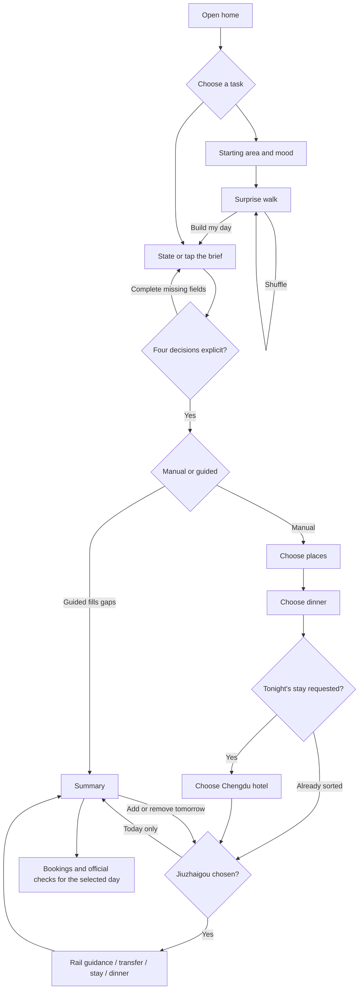
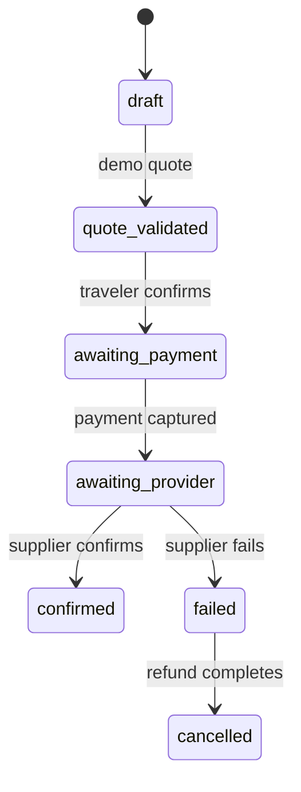

# Chengdu Lens · Product requirements specification (PRD)

> Help first-time international visitors turn their own time, starting point, stay and next destination into a plan they can choose, act on and verify.

| Item | Detail |
| --- | --- |
| Document version | v1.0 |
| Product version | Portfolio prototype v0.4 |
| Owner | Product manager: problem framing, scenarios, requirements, interaction, metrics, AI governance and prototype delivery |
| Readers | Product, design, engineering, QA, content operations and portfolio reviewers |
| Related | [Demo acceptance](demo-spec-en.md) · [Roadmap](product-roadmap-en.md) · [Metrics](product-metrics-en.md) · [Agent design](agent-system-design-en.md) · [Evaluation](agent-evaluation-cases-en.md) · [Evidence](research-evidence-appendix-en.md) · [中文](product-spec-cn.md) |

**Reading guide:** Sections 1–5 explain the product judgment. Sections 6–9 specify interactions, data and state. Sections 10–13 define governance, quality and measurement. Sections 14–15 cover acceptance and evolution. **Current prototype** describes the interactive experience; **evolution** describes proposed capabilities. Targets and validation protocols are planning inputs, with results recorded separately after execution.

## 1. Overview

### 1.1 Positioning
Chengdu Lens is a **city trip-decision assistant** for independent international travelers. It connects spontaneous discovery with deliberate planning: the traveler chooses the task; curated content and deterministic rules turn their stated conditions into an explainable, reversible plan.

### 1.2 Value proposition
**Less input, clearer decisions.** A quick walk needs a starting area and mood. A structured plan captures four explicit decisions—available time, start, tonight and tomorrow—then helps the traveler select places, dinner and any requested stay or regional extension.

### 1.3 Objectives
| Objective | Measure | Proposed target |
| --- | --- | --- |
| Make the first action clear | Visitors entering a travel mode | ≥ 60% |
| Turn stated needs into an actionable plan | Brief starters saving a summary or opening a plan-associated official check | ≥ 35% |
| Preserve traveler agency | Preset scenarios or silent overwrites | 0 occurrences |
| Communicate transaction state accurately | Payment displayed as supplier confirmation | 0 occurrences |

## 2. Context and opportunity

### 2.1 Decision needs
Travelers need personal relevance, understandable local rules and continuity between individual decisions. A place recommendation becomes useful when it explains how to get there, how long to spend, what to eat nearby and what to verify before leaving. A regional day introduces separate rail, road-transfer and overnight decisions.

### 2.2 Product landscape
| Product type | Strength | Chengdu Lens contribution |
| --- | --- | --- |
| Content platforms | Inspiration and breadth | Explain personal fit and connect sources to each recommendation |
| Maps | Locations and navigation | Organize places into a time-budgeted experience |
| OTAs | Standard booking journeys | Support decisions before destination-specific handoff |
| General AI | Natural-language interaction | Ground advice in curated records and independently checked rules |

### 2.3 Opportunity hypothesis
The opportunity is the **decision layer**, not another volume of travel articles. The hypothesis is that explicit choices, visible sources and reversible planning make advice more likely to become an action. This is a product hypothesis; the [evidence appendix](research-evidence-appendix-en.md) describes how to test it.

## 3. Users and scenarios

### 3.1 Initial audience
| Dimension | Detail |
| --- | --- |
| Traveler | English-first independent visitor on a first Chengdu trip |
| Trip | Typically two to four days, with optional regional travel |
| Device | Primarily a phone, opened in a hotel, on the street or in transit |
| Context | Learning Chinese travel apps, reservations and ordering conventions |
| Motivation | Local life, tea, streets, culture and food |
| Explicit constraints | Available time, food preferences, energy and weather |

### 3.2 Segmentation
Recommendation inputs are observable task variables: language, familiarity with travel in China, time, start, diet, stay requirements and selected next destination. Nationality is not a ranking proxy.

### 3.3 Jobs and user stories
The following are **illustrative scenario prompts**, not interview quotations or pre-filled plans.

| Job | Example request | User story | Response |
| --- | --- | --- | --- |
| A · Spontaneous walk | “Near Wenshu, somewhere for tea” | As a traveler with spare time, I want a short surprise route so I can leave without researching | A 1–3 hour walk, shuffle and carry-over |
| B · Plan today | “Four hours from Taikoo Li, no spicy food” | As a traveler planning today, I want to choose places and dinner within my time | Places → dinner → tonight's stay if requested → summary |
| C · Today plus a regional day | “Staying in Chengdu tonight, Jiuzhaigou tomorrow” | As a traveler continuing outside the city, I want each transport and overnight decision explained | B plus rail guidance, transfer, stay and dinner |

These are three entry explanations served by **two modes**, wander and plan. None determines the traveler's brief automatically.

## 4. Principles

| # | Principle | Product expression |
| --- | --- | --- |
| 1 | Traveler-led scope | Required brief fields stay null until stated or tapped; ask for missing decisions |
| 2 | Traveler chooses, assistance fills | Manual and guided completion share one draft; guided completion preserves choices |
| 3 | Facts and advice have different owners | Official sources own prices, schedules, reservations and availability; rules own feasibility |
| 4 | Payment and booking are separate | Simulated payment success leads to supplier confirmation, with a distinct failure/refund path |
| 5 | Reversible decisions | Fair-weather and rain stops are stored separately; tomorrow changes preserve today |
| 6 | Focused decisions | One workbench step at a time; dinner, hotel and transfer branches show up to three options |

## 5. Current experience and evolution

| Capability | Current prototype | Evolution |
| --- | --- | --- |
| Place knowledge | Nine curated Chengdu places with introductions, tickets, transport, nearby picks and sources | Source owners, verification dates and additional neighborhoods |
| Regional extension | Jiuzhaigou journey with Huanglong and Songpan context | A second corridor to validate the destination model |
| Weather | Browser-based Open-Meteo current weather and a one-tap correction | Hourly forecasts and upcoming-rain notices |
| Route duration | Clearly labeled area-based estimates | Licensed map routing and transport data |
| Booking | Destination-scoped simulation and official handoff | Supplier adapters retaining the separate state model |
| AI questions | Streamed questions grounded in curated records and conversation context | Evidence retrieval, typed tools and offline evaluation |
| Language | Chinese and English throughout the journey | Additional languages and ordering cards |

## 6. Information architecture and flow

### 6.1 Structure
```text
Home: product identity + three ways to use it + current weather
  ├─ Wander: starting area + mood → surprise walk → shuffle / build my day
  └─ Plan: sentence + taps → complete brief → guided / manual
       └─ Places → dinner → tonight's stay* → Jiuzhaigou tomorrow* → summary
            └─ Day-specific bookings and official checks → simulated checkout
Place details: introduction, tickets, transport, nearby picks and sources
About: short product introduction → PM view → GitHub documents
* only when requested
```

### 6.2 Mainline


## 7. Functional requirements

P0 denotes the essential journey; P1 supports decision quality; P2 denotes a future enhancement.

### 7.1 Home and entry · P0
| ID | Requirement | Rule |
| --- | --- | --- |
| F-H-01 | Clear identity | Brand and supporting copy identify the travel decision tool |
| F-H-02 | Three ways in | Wander, plan today and optional tomorrow open the relevant mode and work area |
| F-H-03 | Traveler-led first screen | Concrete destinations appear as possibilities, not a preset itinerary |
| F-H-04 | Current weather | Show Chengdu weather and temperature; see 7.2 |
| F-H-05 | Mode memory | Persist wander/plan alongside the browser draft |

### 7.2 Weather awareness · P0
| ID | Requirement | Rule |
| --- | --- | --- |
| F-W-01 | Auto-detect | Request current Open-Meteo weather for Chengdu in the browser |
| F-W-02 | Rain classification | `precipitation > 0.1 mm` or WMO code 51–67 / 80–99 means rain; `src/lib/weather.ts` is authoritative |
| F-W-03 | One-tap correction | A correction immediately updates both travel modes |
| F-W-04 | Status | Loading, live and manual-selection states are explicit |
| F-W-05 | State separation | Detection and override belong to the current visit; fair/rain route selections remain in the persisted plan |

### 7.3 Wander · P0
| ID | Requirement | Rule |
| --- | --- | --- |
| F-R-01 | Start | Taikoo Li, Tianfu Square, Wenshu or Wuhou–Jinli |
| F-R-02 | Mood | Tea, old lanes or indoors |
| F-R-03 | Generate | Add candidates within an estimated 180 minutes, up to three stops |
| F-R-04 | Rain | Recommend indoor or covered places: museum, Wenshu and Fangsuo |
| F-R-05 | Shuffle | Rotate the candidate starting point to vary the combination |
| F-R-06 | Carry-over | Transfer start and stops only; time, tonight and tomorrow remain for the traveler to specify |
| F-R-07 | Route information | Each stop shows image, name and suggested duration; total is labeled estimated |

| Mood | Candidate pool |
| --- | --- |
| Tea | People's Park, Wenshu, Fangsuo, Taikoo Li |
| Old lanes | Jinli, Wenshu, Taikoo Li, People's Park |
| Indoors | Chengdu Museum, Wenshu, Fangsuo |

### 7.4 Brief capture: sentence plus taps · P0
| Field | Required for plan | Options | Parsing example |
| --- | --- | --- | --- |
| Time | Yes | Two hours / half day (240 min) / full day (480 min), or 1–10 hours in text | “three hours” → 180 min |
| Start | Yes | Four supported areas | “from Wenshu”; Chunxi Road maps to Taikoo Li |
| Tonight | Yes | Help choose a Chengdu stay / already sorted | “hotel already booked” → sorted |
| Tomorrow | Yes | Today only / Jiuzhaigou | “tomorrow undecided” or “not Jiuzhaigou” → today only |
| Diet | Optional | No spice / vegetarian | “vegetarian” |
| Interest | Optional | City walk / parks and tea / culture | “tea” → parks and tea |

| ID | Rule |
| --- | --- |
| F-B-01 | Text updates supported chips using only explicit information |
| F-B-02 | Taps correct the parse; the latest action determines the field |
| F-B-03 | Missing fields remain “to pick”; both start actions are disabled and list the missing decisions |
| F-B-04 | Three scenario sentences provide inspiration and populate only on tap |
| F-B-05 | Named destinations such as Leshan, Emei, Dujiangyan, Qingchengshan, Chongqing, Daocheng, Xi'an, Shanghai and Beijing keep their identity; display the coverage message and retain the Chengdu planning path |
| F-B-06 | Wander carry-over fills start and stops while leaving the other required fields for the traveler |

### 7.5 Workbench · P0
| Step | Appears when |
| --- | --- |
| Places | Always |
| Dinner | Always |
| Tonight's Chengdu hotel | Tonight = help choose a stay |
| Tomorrow · Jiuzhaigou | Tomorrow = Jiuzhaigou |
| Summary | Always |

The step bar identifies the current step and allows returning to earlier choices.

#### 7.5.1 Places
| ID | Rule |
| --- | --- |
| F-P-01 | City pool: Jinli, Taikoo Li, Wenshu, People's Park, Chengdu Museum and Fangsuo; rain uses indoor candidates |
| F-P-02 | Calculate time before adding; over-budget choices show “Won't fit” and remain unselected |
| F-P-03 | Order stops by proximity to the starting area; update the route strip and total |
| F-P-04 | Keep separate fair-weather and rain selections; retain indoor stops and fill rain alternatives; switching back restores the fair route |
| F-P-05 | Cards open place details |

**Estimate:** start-to-first-stop travel + suggested visits + inter-stop travel + 10-minute changeover buffers. Nearby legs use walking estimates; longer legs use transit/taxi estimates. The UI labels all durations as estimates, and the route module owns the calculation.

#### 7.5.2 Dinner
| ID | Rule |
| --- | --- |
| F-D-01 | Use the last stop's area as the anchor; rank by proximity and show up to three choices |
| F-D-02 | Vegetarian preferences filter choices and favor suitable Wenshu options |
| F-D-03 | Include ordering guidance and map search terms; dietary requests are confirmed with the venue |

#### 7.5.3 Tonight's stay
Three area choices explain different priorities: East Railway Station for morning departures, Taikoo Li for central access, and Wuhou for Jinli proximity. Each explains branch, room and onward-transport checks.

#### 7.5.4 Jiuzhaigou tomorrow
Rail guidance identifies **Huanglong Jiuzhai Station as a separate location from the park gate**. The workbench then offers:

| Branch | Candidates | Verification |
| --- | --- | --- |
| Onward transfer | Bus / taxi or car / ask the hotel | Confirm departure, destination and any hotel pickup in writing |
| Stay | Demo inn / Holiday Inn Express / Hilton resort | Confirm location relative to the gate and room details |
| Dinner | Local home-style / hotel meal / vegetarian nearby | Confirm serving times against arrival |

#### 7.5.5 Summary
| ID | Rule |
| --- | --- |
| F-S-01 | Group chosen items under today and tomorrow |
| F-S-02 | Save on device; subsequent edits mark the plan as changed |
| F-S-03 | Add or remove Jiuzhaigou tomorrow while preserving today |
| F-S-04 | Each day opens bookings and official checks for its own destination |

### 7.6 Guided completion · P0
“Let AI plan it” is a reproducible, **rule-based completion action**, separate from live language-model chat.

| Item | Completion rule |
| --- | --- |
| Places | Preserve selected stops; otherwise choose by interest and weather within the budget, up to three |
| Dinner | Preserve an existing choice; otherwise select the first suitable candidate |
| Chengdu hotel | Fill only when requested; default candidate is the East Station area |
| Jiuzhaigou | Fill only once chosen: bus, suitable dinner and Holiday Inn Express candidate |
| Finish | Open summary; all steps remain editable |

### 7.7 Bookings and simulated checkout · P0
| ID | Requirement | Rule |
| --- | --- | --- |
| F-K-01 | Scope | Show only the selected day's destination |
| F-K-02 | Channel | Distinguish simulated hotel checkout, official rail/park handoff and venue payment |
| F-K-03 | Quote | Local demo quote with fees and cancellation terms, labeled simulated |
| F-K-04 | Separate state | Display payment and supplier confirmation independently |
| F-K-05 | Failure/refund | Exercise “paid, supplier failed” → refund → cancellation |
| F-K-06 | Transfer detail | Identify rail pickup and bus-stop pickup separately, with verification status |
| F-K-07 | Transition safety | Ignore duplicate or invalid operations; preserve a reviewable history |



Payment states: `not_started → pending → captured`, with `failed`, `cancelled`, `refund_pending` and `refunded` tracked independently. Confirmation copy follows supplier state, not payment state. All demo identifiers refer to the simulation.

### 7.8 Place details · P1
Each record includes fit rationale, introduction, tickets/reservations, transport, suggested timing, nearby food and activities, suitability considerations, sources, evidence grade and official links. Details open from wander, workbench and supported AI place references.

### 7.9 Open AI questions · P1
| ID | Rule |
| --- | --- |
| F-A-01 | Ground answers in curated place/region records and conversation context |
| F-A-02 | Route volatile facts such as schedules, opening and ticket prices to official verification |
| F-A-03 | Booking and payment require traveler actions; generated text remains advice |
| F-A-04 | Stream answers; offer clear status and retry when the service is busy |

### 7.10 Languages · P0
Chinese and English cover entries, choices, status and outcomes. Switching language preserves progress. English uses concise action-oriented wording with the same meaning as Chinese.

## 8. Content and data

### 8.1 Place record
| Field | Meaning |
| --- | --- |
| id / name / zhName | Stable identity and bilingual names |
| area / duration / indoor | Area, suggested minutes and indoor/covered eligibility |
| whyFits / intro | Bilingual rationale and introduction |
| ticket / transit / bestTime | Reservation, transport and timing guidance |
| nearby / notFor / spiceRisk | Nearby picks, suitability considerations and dietary checks |
| sources / evidenceGrade | Source links and editorial evidence grade |
| image | Media reference with alternative text and license provenance |

### 8.2 Options
Dinner, hotel, transfer and regional dinner use stable IDs, bilingual names/descriptions, area and map search terms. Each branch presents up to three comparable choices.

### 8.3 Regional records
Jiuzhaigou, Huanglong, Songpan and Huanglong Jiuzhai Station have distinct identities. Transfer records specify pickup/drop-off points and verification requirements.

### 8.4 Source policy
Use official sources for operational facts, licensed or owned imagery with attribution, and link-level third-party references. Editorial judgment remains labeled as advice. Display “verify before leaving” for time-sensitive details.

## 9. State and persistence

| State | Content | Storage |
| --- | --- | --- |
| Entry mode | Wander / plan | Browser, restored on refresh |
| Draft | Nullable required fields, diet, interest and carried stops | Browser |
| Plan | Brief, step, mode, fair/rain stops, dinner, hotels, transfer and saved marker | Browser |
| Wander | Mood, shuffle seed and start | Browser |
| Current weather | Detection, temperature and manual correction | Current visit |
| Booking simulation | Quote, payment, supplier state and transition history | Current drawer |

Manual and guided completion use one planner draft. Browser storage does not require identity collection. Live-chat requests contain the question and supplied conversation context; future analytics should use structured behavior rather than raw text.

## 10. AI design and governance

### 10.1 Ownership
| Layer | Owns | Handoff |
| --- | --- | --- |
| Deterministic | Time estimates, weather swaps, steps, guided completion, booking scope and state | Provides validated choices |
| Curated | Places, nearby picks, transport and source references | Sends volatile facts to official channels |
| Language | Open-question understanding and explanations | Leaves planning and transactions to explicit actions |

### 10.2 Decisions
| Question | Decision | Rationale |
| --- | --- | --- |
| Rules before model? | Compute time and state with rules | Testable and reproducible outcomes |
| Booking in chat? | Independent drawer | Explicit confirmation and reviewable state |
| Model for guided completion? | Deterministic gap filling | Preserves choices and stable demo behavior |
| Regional coverage? | Deep Jiuzhaigou journey first | Validate the city-plus-region chain before replicating |

### 10.3 Evaluation
Assess accuracy, feasibility, scope, diet and traveler agency. Automated domain checks and human-reviewed AI outputs are separate evidence tracks. Proposed tool and retrieval architecture lives in [Agent design](agent-system-design-en.md); execution templates live in [Evaluation](agent-evaluation-cases-en.md).

## 11. Quality requirements

| Category | Acceptance objective |
| --- | --- |
| Mobile | Complete the journey from a 360 px-wide viewport |
| Performance | Proposed first-interaction target < 2.5 seconds on 4G; local choices respond immediately |
| Reproducibility | Guided planning and simulation run independently of live AI/payment services |
| Accessibility | Readable action labels, text status, keyboard access and WCAG AA contrast target |
| Privacy | Browser-held drafts; structured analytics properties; explicit handling of chat context |
| Testability | Domain rules are browser-safe pure modules, testable without rendering |

## 12. Metrics and events

### 12.1 Canonical metric
**Actionable Plan Rate** = unique structured-brief starters who reach summary and save it or open a plan-associated official check ÷ unique structured-brief starters, within the same session. Count each session once; direct detail clicks before a plan do not qualify. Wander has a separate activation metric.

| Level | Metric | Definition |
| --- | --- | --- |
| North star | Actionable Plan Rate | Formula above |
| Diagnostic | Landing entry | Mode entrants ÷ visitors |
| Diagnostic | Brief completion | Briefs with four explicit required fields ÷ briefs started |
| Diagnostic | Time to first plan | Median plan-entry-to-summary duration |
| Diagnostic | Guided share | Guided plans ÷ plans started |
| Diagnostic | Wander carry-over | Expanded wander sessions ÷ sessions generating a wander route |
| Diagnostic | Regional continuation | Summary sessions choosing a regional day ÷ summary sessions |
| Guardrail | Traveler agency | Preset scenarios and silent overwrites: 0 |
| Guardrail | Destination scope | Unchosen destination bookings: 0 |
| Guardrail | Simulation integrity | Incorrect confirmation or incomplete refund after simulated supplier failure: 0 |

### 12.2 Event specification · proposed instrumentation
The table defines implementation contracts, not a claim that the current planner emits a complete analytics stream. An analytics rollout follows schema and privacy review.

| Event | Trigger | Properties |
| --- | --- | --- |
| `entry_selected` | Entry or mode chosen | entry: wander / today / tomorrow |
| `brief_started` | First explicit field/text edit per session | entry, language |
| `weather_detected` | Detection/correction completed | rain, temperature, source |
| `wander_generated` | Generation or shuffle | mood, start, stop IDs, total minutes, rain |
| `wander_expanded` | Carry-over | stop IDs |
| `brief_field_set` | Required field set | field, method: text / tap |
| `brief_unsupported` | Named destination coverage message | recognized destination ID |
| `plan_started` | Manual/guided start | mode |
| `step_completed` | Workbench decision completed | step, option ID, rain |
| `stop_rejected_time` | Over-budget attempt | place ID, estimate, budget |
| `tomorrow_toggled` | Add/remove regional day | selected destination |
| `summary_viewed` | Summary reached | mode, destination IDs |
| `plan_saved` | Save summary | mode, step count |
| `booking_opened` | Day-specific drawer opened | destination |
| `quote_requested` / `payment_result` / `refund_completed` | Simulation transitions | item ID, state, simulated: true |
| `official_link_clicked` | Official handoff | provider, context, plan associated |

Use an ephemeral session ID for joins. Exclude raw brief/chat text, precise location history and identity fields. [Metrics](product-metrics-en.md) owns deduplication, denominators and dashboard interpretation.

## 13. Copy requirements

Use traveler-facing actions, label time as estimated and prices as simulated, distinguish confirmation from payment, and keep source-check wording actionable. Chinese and English convey the same promise. Portfolio detail stays in GitHub documents after the travel experience.

## 14. Acceptance

| ID | Given | When | Then |
| --- | --- | --- | --- |
| AC-01 | First visit | Open home and planner | Required brief fields remain to pick; plan-start actions disabled |
| AC-02 | Wenshu and tea mood | Generate wander | Two to three stops within the estimated 180-minute budget |
| AC-03 | Rain | Generate wander or open places | Indoor/covered candidate pool |
| AC-04 | Wander route | Build my day | Start/stops carried; time, tonight and tomorrow remain to pick |
| AC-05 | Empty brief | Inspect start actions | Both disabled, missing fields listed |
| AC-06 | “Three hours from Wenshu” | Parse | 180 min and Wenshu; remaining required fields null |
| AC-07 | Full day, Tianfu, stay sorted, today only | Guided completion | Places, dinner and summary only |
| AC-08 | Two selected places | Guided completion | Both preserved |
| AC-09 | Budget nearly used | Add a long stop | Show time constraint; route unchanged |
| AC-10 | Fair-weather route | Rain then fair | Indoor alternative; original fair selections restored |
| AC-11 | Today-only summary | Add then remove Jiuzhaigou | Tomorrow changes, today preserved |
| AC-12 | Vegetarian or no-spice preference | Choose dinner | Suitable options and ordering guidance |
| AC-13 | Today only | Open bookings | Chengdu items only |
| AC-14 | Demo hotel | Payment succeeds, supplier fails | Simulated refund and cancelled booking |
| AC-15 | Text names Leshan | Parse | Coverage message; destination identity preserved |
| AC-16 | Language switch / narrow screen | Repeat mainline | Actions and outcomes usable, progress retained |

`src/lib/travel-plan.test.ts` and `src/lib/journey.test.ts` cover domain rules. [Demo acceptance](demo-spec-en.md) defines walkthrough tasks. Each release records the actual cases, version, language and observed results separately.

## 15. Delivery and evolution

| Milestone | Focus | Decision gate |
| --- | --- | --- |
| M1 · Prototype | Two modes, brief-driven workbench, regional extension, simulation and bilingual flow | Relevant domain tests and mainline walkthrough |
| M2 · Validation | Proposed usability sessions, offline AI evaluation and event rollout | Task observations plus canonical metrics, clearly labeled by evidence type |
| M3 · Expansion | Second regional route, source dates and hourly weather | Complete destination data, verification and regression checks |
| M4 · Connected services | Licensed maps and verified supplier interfaces | Explicit user confirmations and reviewed state contracts |

Next decisions: which corridor best tests a different trip length; whether confirmed preferences improve ranking; which official service handoff most improves actionability. Choose using observed task evidence rather than feature count.

## Appendix A · Terms

| Term | Meaning |
| --- | --- |
| Brief | Explicit time, start, tonight and tomorrow decisions |
| Draft | In-progress brief with nulls for unstated fields |
| Guided | Rule-based completion of remaining selections |
| Workbench | Brief-derived steps and comparable choices |
| Regional day | Traveler-chosen extension requiring separate transport and stay decisions |
